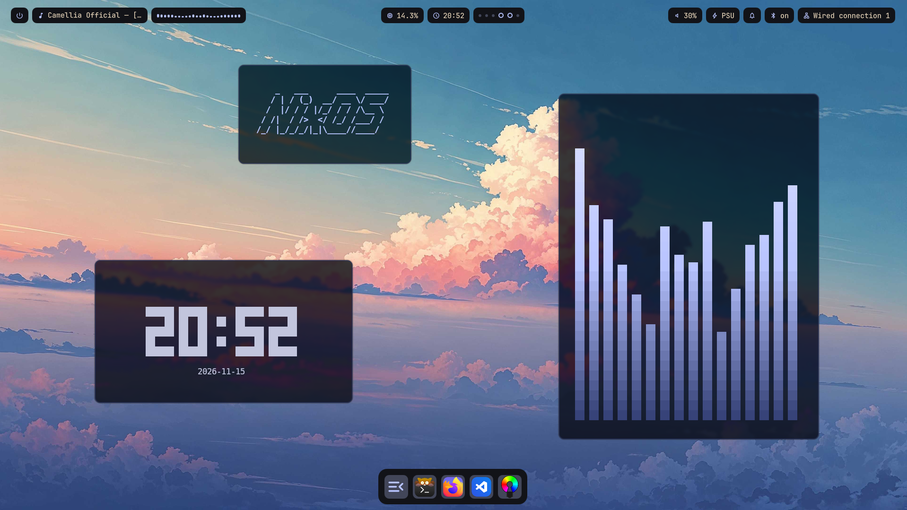
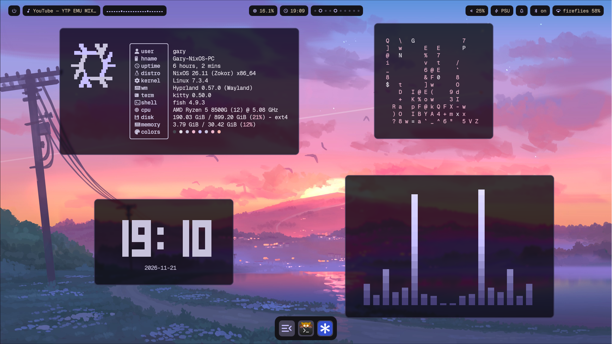

# My NixOS Dotfiles
This is my personal NixOS configuration Dotfiles for my PC

My configuration has lots of packages and flakes preinstalled




## Features

- Hyprland
- Quickshell
- Home Manager
- Matugen
- Fish Shell
- Qylock sddm themes
- Plymouth Boot themes
- Modular configuration

I am developing the shell called GazShell that you have seen on screen. if you wish to install this dotfiles it will come in the next release

## Important

Before installation there are a few things you should know

## Username

It should be noted that in users.nix that the automatic user is named gary.

- [`modules/system/users.nix`](modules/system/users.nix)

If you wish to change the username feel free to.

## Hostname

the hostname is another setting you many want to change.
if you wish to change the hostname edit the files below and change the hostname under them to prevent build errors

- [`modules/system/networking.nix`](modules/system/netoworking.nix)
- [`flake.nix`](flake.nix)
- [`home.nix`](home.nix)

Make sure the hostname is named to your needs.

## Hardware configuration

the hardware-configuration.nix file is specific to my PC.

You should generate your own hardware configuration file when installing this system rather than blindly reusing mine.

## installation

before installing please check the important section above to prevent build errors

# 1. Clone the Repository


```console
$ git clone https://github.com/SecretScripter32/nixos-config.git
$ cd nixos-config
```

# 2. Configure Apply The configuration

Once you've made the necessary changes, run:

```console
$ sudo nixos-rebuild switch --flake "$PWD#nixos"
```

